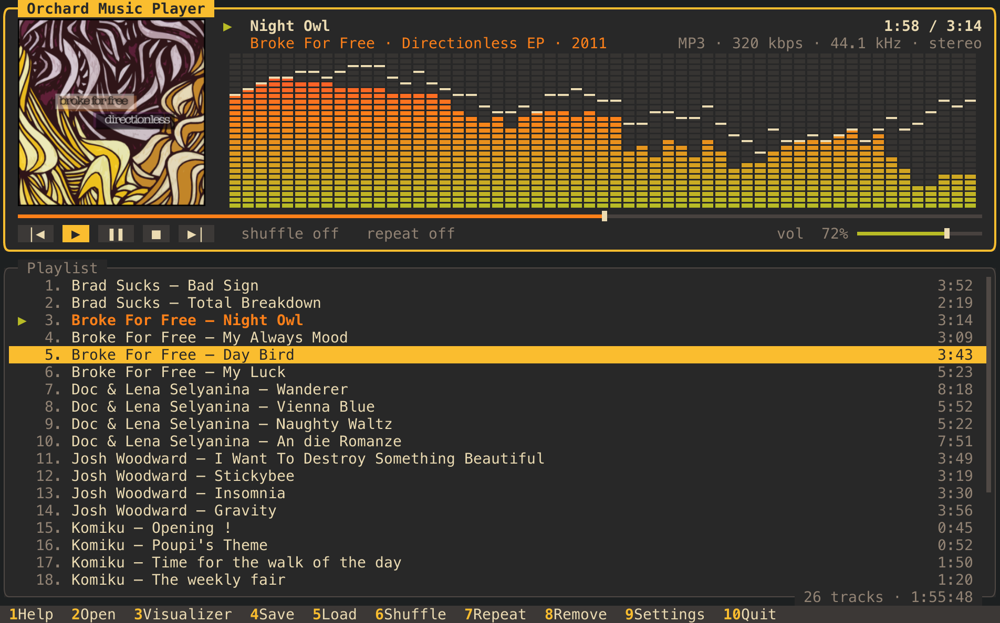

# Orchard Music Player

A themeable, Winamp-style music player from the Orchard family. It is
drawn as a character grid on the GPU, like Orchard Commander: same
renderer (`oc-grid`), same color schemes, same frame look.



* Plays MP3, Ogg Vorbis, Opus, FLAC, WAV, AAC/M4A, AIFF, CAF (symphonia;
  Opus through a bundled libopus).
* Gapless: the next track is queued ahead and joins without a break.
* ReplayGain (track or album, clipping-safe; Opus R128 gains too).
* Media keys and the system's Now Playing with cover art (macOS, Linux).
* Playlist: open files and folders (recursively), drag & drop onto the
  window, reorder, remove, shuffle, repeat off/all/one, quick filter.
* M3U / M3U8 load and save (extended M3U, paths relative to the playlist).
* Tags, stream details and cover art for the playing track.
* Spectrum analyzer with peak caps, or an oscilloscope.
* Color schemes shared with Orchard Commander: the built-ins plus every
  scheme in Commander's `color-schemes/` folder; live preview (T).
* Settings (⌘, or F9) like Orchard Commander's: color scheme (optionally
  one for light and one for dark mode), font, size, line spacing, frames,
  ReplayGain; a color scheme editor whose schemes Commander sees too.
  Changes apply and are saved at once.
* Remembers the playlist, volume, modes and window size between runs.

## Building

```sh
cargo build --release
./target/release/orchard-music-player [FILE|FOLDER|PLAYLIST.m3u]...
```

It uses crates from [Orchard Commander](https://github.com/sandboxly/orchard-commander),
fetched by cargo at a pinned Commander release:

| crate       | used for                                         |
|-------------|--------------------------------------------------|
| `oc-grid`   | the wgpu character-grid renderer and winit       |
| `oc-config` | color schemes, frame styles, the schemes folder  |
| `oc-rename` | reading audio tags (its `AudioTags` provider)    |

## Keys

| key                       | does                                   |
|---------------------------|----------------------------------------|
| Space                     | play / pause                           |
| Enter, double-click       | play the selected track                |
| Z X C V B                 | previous · play · pause · stop · next  |
| ← → (⇧: 30 s)             | seek 5 s (or click / drag the bar)     |
| + − , wheel over player   | volume                                 |
| ↑ ↓ PgUp PgDn Home End    | selection; ⌥↑ ⌥↓ moves the track       |
| Del / ⇧Del                | remove track / clear playlist          |
| S / R / A                 | shuffle / repeat / visualizer mode     |
| J                         | jump to the playing track              |
| / or ⌘F                   | filter the playlist (Esc clears)       |
| G                         | ReplayGain track · album · off         |
| T                         | color scheme, quick pick               |
| ⌘, or F9                  | settings                               |
| ⌘O ⌘L ⌘S                  | open · load playlist · save playlist   |
| ⌘+ ⌘− ⌘0                  | font size                              |
| F1–F10                    | as on the key bar                      |

In the file browser: Enter opens a folder or adds a file, Space/Insert
marks, `*` marks all files, F3 or ⇧Enter adds the whole folder, Backspace
goes up, `~` goes home, typing jumps to a name.

## Files

Settings and the session playlist live in the platform config folder
(`~/Library/Application Support/Orchard Music Player` on macOS,
`~/.config/orchard-music-player` on Linux), or in
`$ORCHARD_MUSIC_PLAYER_CONFIG_DIR`.

## Development

```sh
cargo test
OMP_TEST_MUSIC=/path/to/some/music cargo test -- --nocapture   # decode + tag real files
orchard-music-player --screenshot out.png [--size 110x36] [--theme nord] [--dialog help|themes|save|filter|browser]
# real files: their tags and cover, the visualizer fed with the decoded audio; .webp saves lossless WebP
orchard-music-player --screenshot out.webp --music DIR [--play N] [--at SECONDS] [--vis bars|scope] [--cursor N] [--filter TEXT]
```
